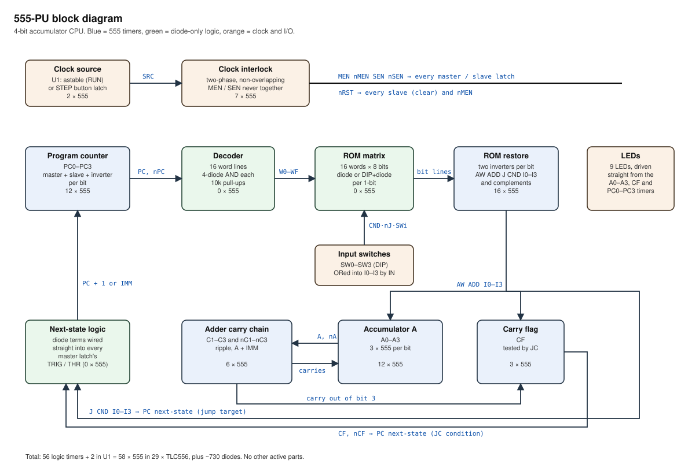

# 555-PU — a 4-bit CPU made of 555 timers

A deliberately tiny CPU where **every active part is a 555 timer**. The rest of
the board is diodes, resistors and switches. It has a program counter, a 16-word
program ROM, a 4-bit accumulator, a ripple-carry adder, a carry flag,
conditional jumps and a 4-bit input port.

| | |
|---|---|
| Data width | 4 bits (accumulator `A`, carry flag `C`) |
| Program | 16 × 8-bit words, diode matrix or DIP switches |
| Instructions | `LDI`, `ADD`, `IN`, `JMP`, `JC`, `NOP`, and combinations of them |
| I/O | 4 input switches; LEDs on `A`, `C` and `PC` |
| 555s | **58**: 56 logic + astable clock + step-button latch, in **29 × TLC556** |
| Other parts | ~730 1N4148 diodes (+ one per 1-bit in the program), ~210 resistors, ~90 capacitors |
| Supply | 9 V, CMOS 555s (TLC555 / LMC555 / ICM7555, or TLC556 duals) |
| Speed | single-step up to about 1 kHz; run it at 1–10 Hz to watch the LEDs |

`sim/cpu555.py` is the source of truth. It generates the whole netlist, simulates
it one 555 at a time with random gate delays, and checks the result against a
plain model of the instruction set. It writes two files:

* [NETLIST.md](NETLIST.md): a readable wiring list, timer by timer, with the 556
  package and half for each one.
* [netlist.csv](netlist.csv): every part and every connection, including package
  pin numbers and the peripheral circuits.
* [docs/](docs/): the block diagram and schematics below, drawn by
  `sim/drawings.py` from the same netlist.

```
python sim/cpu555.py                          # run the tests, regenerate netlists and drawings
python sim/cpu555.py programs/countdown.asm   # trace a program
python sim/cpu555.py programs/double.asm 6    # trace with the input switches set to 6
```



### Schematics

The logic sheets are generated from the tested netlist, so every diode on them
is one the simulator checked. Each 555 is labelled with its TLC556 package and
half (e.g. `U18A`) and its package pin numbers.

| sheet | contents |
|---|---|
| [conventions](docs/schematics/conventions.svg) | how to read the sheets: INV, LATCH, diode-AND, diode-OR, the 556 pin map |
| [peripherals](docs/schematics/peripherals.svg) | astable (U1A), step latch (U1B), RUN/STEP selector, reset, LEDs, input switches |
| [clock](docs/schematics/clock.svg) | the 7-timer two-phase interlock |
| [rom](docs/schematics/rom.svg) | decoder, 16 × 8 diode matrix (filled in for `countdown.asm`), input-port terms, 16 restore inverters |
| [carry](docs/schematics/carry.svg) | adder carry chain C1–C3 / nC1–nC3 |
| reg-[PC0](docs/schematics/reg-PC0.svg) [PC1](docs/schematics/reg-PC1.svg) [PC2](docs/schematics/reg-PC2.svg) [PC3](docs/schematics/reg-PC3.svg) | program counter bits: master (with jump / +1 logic), slave, inverter |
| reg-[A0](docs/schematics/reg-A0.svg) [A1](docs/schematics/reg-A1.svg) [A2](docs/schematics/reg-A2.svg) [A3](docs/schematics/reg-A3.svg) | accumulator bits: master (with load / add / hold logic), slave, inverter |
| [reg-CF](docs/schematics/reg-CF.svg) | carry flag |

---

## 1. Instruction set

Every instruction is one byte. The top four bits are control lines that go
straight to the hardware with no decoder. The bottom four bits are the immediate.

```
 bit  7    6    5    4    3 2 1 0
     AW  ADD   J   CND    IMM
```

| bit | when set |
|---|---|
| `AW`  | write the accumulator and carry flag this cycle |
| `ADD` | `A ← A + IMM`, `C ← carry out` (otherwise `A ← IMM`, `C ← 0`) |
| `J`   | jump to `IMM` ... |
| `CND` | ... but only if `C` is set. Without `J`, the input switches are ORed into `IMM` instead |

| mnemonic | hex | effect |
|---|---|---|
| `NOP`         | `00` | |
| `LDI n`       | `8n` | `A ← n`, `C ← 0` |
| `ADD n`       | `Cn` | `A ← A + n`, `C ← carry` |
| `IN`          | `90` | `A ← switches`, `C ← 0` |
| `ADD \| IN`   | `D0` | `A ← A + switches`, `C ← carry` |
| `JMP n`       | `2n` | `PC ← n` |
| `JC n`        | `3n` | `if C: PC ← n` |
| `LDI n \| JMP n` | `An` | both at once |
| `ADD n \| JMP n` | `En` | both at once |
| `ADD n \| JC n`  | `Fn` | both at once. The jump tests `C` from *before* the add |

Every instruction takes one clock cycle. In the combined forms both halves share
the same immediate, and the assembler rejects combinations that would mean
something else (e.g. `IN | JMP`).

Subtract by adding the two's complement: `ADD 15` is `A − 1`. It leaves `C = 1`
unless `A` was 0, so it doubles as a "was zero?" test. To halt, jump to the
current address.

```asm
; double.asm: show twice the value on the input switches, over and over
IN          ; A = switches, C = 0
ADD | IN    ; A = A + switches, C = carry (set if switches >= 8)
JMP 0
```

More programs are in [programs/](programs/): `counter`, `countdown`,
`knight_rider`, `add_overflow`. The tests run every `.asm` file in that folder.

---

## 2. Making logic out of a 555

A 555 is two comparators and an SR flip-flop. That is enough to build every
part of a computer. Pins are named by **function** throughout, because a 556
numbers them differently (see [§8](#8-the-556-pin-trap)).

```
             ┌───────────┐
  TRIG ──────┤ < 1/3 Vcc ├──► SET   (wins)        OUT high
  THR  ──────┤ > 2/3 Vcc ├──► RESET               OUT low
  RST  ──────┤   low     ├──► force OUT low (overrides everything)
             └───────────┘          neither: hold
```

The design uses a 555 in only two ways:

* **INV.** TRIG and THR are tied together as one input. Low in gives high out,
  high in gives low out. It is a Schmitt-trigger inverter that restores clean
  logic levels.
* **LATCH.** TRIG and THR are driven separately: TRIG low sets the output, THR
  high resets it, and anything else holds it. This is one bit of memory. The
  logic never asks for set and reset at the same time.

There are no other gates. All logic is **diode-resistor logic** in front of those
pins:

```
 555 outputs ──|◄── AND node ──|►──┐               (AND: diode cathodes to inputs,
 555 outputs ──|◄──┘  (100k↑)      ├── OR node ──► TRIG / THR       100k pull-up)
 555 output  ───────────────|►─────┘   (1M↓)       (OR: diode anodes from terms,
                                                     1M pull-down)
```

**The one design rule:** between two 555s a signal goes through at most one
diode-AND and then one diode-OR. That is a sum of products, so any boolean
function fits. The rule exists because diode gates have no gain:

* An AND node can only be pulled low hard if its inputs are strong 555 outputs.
  An AND that followed an OR would be driven by a 1M pull-down and couldn't sink
  the 100k pull-up current.
* An OR can only pass a high if the AND node feeding it has a pull-up much
  stronger than the OR's pull-down.

One level of each, with 100k against 1M, keeps both margins (§9). Because AND
inputs must be 555 outputs, any signal needed in both polarities gets an
inverter: `nX` is always an inverter 555 driven by `X`.

## 3. Registers: next-state logic folded into the latch

Each state bit (`PC0–3`, `A0–3`, `C`) is a master-slave flip-flop built from two
555 latches, plus one inverter that supplies `nX`. That is **3 × 555 per bit**.

The design saves parts here. A latch needs a "set when" network on TRIG and a
"reset when" network on THR. Both are sums of products, so **the next-state
logic is wired straight into the master's pins.** There is no separate adder
output, multiplexer or incrementer. Those functions are diode terms on the
latch inputs.

```
master m  (stores NOT x):  TRIG = OR( x_next terms…, nMEN )          → low  ⇒ m = 1
                           THR  = OR( each x_next term · MEN )       → high ⇒ m = 0
slave  x:                  TRIG = OR( m, nSEN )                      → low  ⇒ x = 1
                           THR  = AND( m, SEN )                      → high ⇒ x = 0
                           RST  = nRST
```

The master stores the inverted bit so the slave can use the master's output
directly, with no inverter in between.

The next-state functions (`x_next`) that get folded in:

| bit | x_next (sum of products) |
|---|---|
| `A[i]` | `AW·nADD·I[i]` + `AW·ADD·(odd-parity minterms of A[i], I[i], C[i])` + `nAW·A[i]` |
| `C` | `AW·ADD·(A3·I3 + A3·C3 + I3·C3)` + `nAW·C` |
| `PC[i]` | `taken·I[i]` + `not_taken·(PC + 1)[i]`, with `taken = J·nCND + J·C`, `not_taken = nJ + CND·nC` |

When `AW = 0`, the `nAW·A[i]` term feeds the bit back to itself, so the register
holds. Every master opens on every clock. Gating the master with `AW` instead
would leave a master that hadn't been written since power-up holding a random
value after reset.

## 4. Adder

The adder ripples a carry through bits 0–3. The sum bits need no 555s because
they are folded into the `A` latches as above. Each carry between bits needs
two 555s, because the next bit's terms need both `C[i]` and `nC[i]`:

```
nC[i+1] = INV( A·I + A·C + I·C )        C[i+1] = INV( nA·nI + nA·nC + nI·nC )
```

`C1`, `C2` and `C3` take **6 × 555**. The carry out of bit 3 goes straight into
the carry-flag latch.

## 5. Program ROM and input port

* **Decoder:** 16 word lines, each a 4-diode AND of `PC`/`nPC` (10k pull-ups,
  because each word line drives up to 8 bit lines).
* **Matrix:** 8 bit lines, each a diode-OR. Fit a diode from word `n` to bit `b`
  wherever that bit is 1. For a reprogrammable ROM, put a DIP switch and a diode
  at all 128 crossings.
* **Input port:** each immediate bit line `I0–3` also takes one extra term,
  `CND·nJ·SWi`. In other words, `IN` is just "OR the switches into the
  immediate". It costs 16 diodes and no 555s.
* **Restore:** decoder plus matrix is already one AND and one OR, so each bit
  line goes into an inverter 555 (`nI0`, `nAW`, …). A second inverter gives the
  true polarity. That is **16 × 555**.

## 6. Clock: interlocked two-phase

A master-slave flip-flop must never have both latches transparent at once. A
slave output such as `A3` feeds the master's diodes directly, so even a
one-gate overlap corrupts the master. A naive `CLK`/`nCLK` pair from two
inverters fails in the simulator.

This design uses a non-overlapping clock in which each phase is interlocked on
the other phase's *last* signal:

```
nSRC = INV(SRC)
nMEN = INV( SRC · SOFF )   ← RST = nRST     MEN = INV(nMEN)   MOFF = INV(MEN)
nSEN = INV( nSRC · MOFF )                   SEN = INV(nSEN)   SOFF = INV(SEN)
```

The masters open only after the slave's chain has reported closed (`SOFF`), and
the slaves open only after `MOFF`. If `SRC` is clean, this works for any gate
delays, and the simulator checks that the two phases never overlap. It does
**not** protect against glitches on `SRC` itself: a pulse shorter than the
chain delay can close a phase before every latch has copied, which corrupts the
state (see [Known issues](#known-issues)). It costs **7 × 555**.

**Reset:** `nRST` goes to RST of every slave and of `nMEN`. All state clears to
0, and the masters are held open, so they already hold the result of
instruction 0. On release, the next slave phase executes it.

## 7. Peripheral circuits

All of these are also in [netlist.csv](netlist.csv). Timer U1A is the astable
and U1B is the step latch.

**RUN clock (astable, U1A).** It uses the standard astable wiring:

* 10k from VCC to DIS
* DIS → 10k + 100k pot (as rheostat) → THR and TRIG, joined
* 4.7 µF from THR/TRIG to GND
* RST to VCC, 10 nF on CV

The frequency is f = 1.44 / ((R1 + 2·R2)·C), which gives about **1.3–10 Hz**.
The output goes to `SRC_RUN`.

**STEP button (U1B).** The latch is debounced by an SPDT momentary push-button
with its common to GND:

* the normally-open contact goes to TRIG
* the normally-closed contact goes to RST
* each contact has a 10k pull-up
* THR goes to GND

Pressing the button sets the output, releasing it resets it, and bounce while
the contact is moving between them just holds. The output goes to `SRC_STEP`.
Press for the master phase; on release the slaves copy, so the LEDs update when
you let go.

**RUN/STEP selector.** An SPDT toggle with `SRC` on the common and the throws to
`SRC_RUN` and `SRC_STEP`. Fit a **100k pull-up on `SRC`**, so it rests in the
harmless master phase while the contacts are in transit. **Hold RESET while
changing this switch** (see Known issues).

**Reset.** The `nRST` line:

* 10k pull-up to VCC
* 10 µF to GND, for power-on reset
* a push-button to GND
* a 1N4148 from `nRST` (anode) to VCC (cathode), which discharges the
  capacitor at power-off

**Input switches.** One 4-way DIP switch, each position from VCC to `SWi`, with
a 4.7k pull-down on each `SWi`. ON means 1. The 4.7k is strong enough to hold
the AND input at about 0.4 V against its 100k pull-up.

**LEDs.** `A0–3`, `CF` and `PC0–3`. Use high-efficiency LEDs, each with a 4.7k
series resistor straight from the timer output to GND.

## 8. The 556 pin trap

The 556 is the natural package: two timers per chip, so 29 chips. **Its pin
numbers do not match the 555's:** on timer A, pin 2 is THR and pin 6 is TRIG,
which is exactly backwards. If you wire a 556 by 555 pin numbers, every latch
has set and reset swapped. The netlists name pins by function and give each
timer a package half (`U12A`). Wire from this table:

| function | 555 | 556 timer A | 556 timer B |
|---|---|---|---|
| TRIG | 2 | 6 | 8 |
| THR  | 6 | 2 | 12 |
| RST  | 4 | 4 | 10 |
| OUT  | 3 | 5 | 9 |
| CV   | 5 | 3 | 11 |
| DIS  | 7 | 1 | 13 |
| GND / VCC | 1 / 8 | 7 / 14 | 7 / 14 |

## 9. Electrical notes

* **Use CMOS 555s** (TLC555, LMC555, ICM7555, or TLC556 duals) at **9 V**.
  Rail-to-rail outputs and near-zero input current make diode logic easy:
  * the thresholds are 3 V and 6 V
  * an AND-then-OR high is about 7.5 V, about 1.5 V of margin
  * an OR output low is about 0.3 V

  A bipolar NE555 output only reaches about Vcc − 1.7 V. If you must use NE555s,
  run them at 12 V and recheck the resistor values.
* Resistors: 100k AND pull-ups, 1M OR pull-downs, 10k word-line pull-ups. The
  worst fan-out (`nPC0`) sinks about 9 mA, well within a TLC555's 100 mA.
* Fit 100 nF across the supply at every package and 10 nF from each CV to GND.
  DIS is unused on the logic timers. RST goes to VCC except on the slaves and
  `nMEN`.
* **Speed.** The slow edges are the 1M OR nodes falling: τ ≈ 1M × ~50 pF ≈
  50 µs. The longest path (PC → word line → bit line → restore → carry chain →
  master) has about six of them, so allow roughly 0.5 ms per clock phase. That
  limits the clock to about 1 kHz.

## 10. Building it

1. **Prove the cell first.** On a breadboard, build one inverter and one latch.
   Drive the latch's TRIG and THR from a 1M pull-down / 100k pull-up with a
   diode from a switch, and check set, reset and hold with a meter at 9 V.
2. **Build one register bit** (`mA0`, `A0`, `nA0`) with its THR/TRIG networks.
   Drive `MEN`/`nMEN`/`SEN`/`nSEN` from switches in the order the clock would,
   and confirm the bit only changes during the slave phase.
3. **Clock board.** Build U1 and the seven clock timers. In STEP mode, check
   with LEDs that `MEN` and `SEN` are never on together, and that each press
   and release walks `nMEN → MEN → MOFF → nSEN → SEN → SOFF` in order.
4. **PC + ROM.** Build the PC bits, the decoder and the ROM restore timers.
   Program `JMP` instructions only and single-step: the PC LEDs should follow
   the jumps.
5. **Adder and A.** Add the carry chain and the `A`/`C` bits. Single-step
   `programs/add_overflow.asm` and compare each step with
   `python sim/cpu555.py programs/add_overflow.asm`.

Each timer's networks are listed in NETLIST.md. netlist.csv has one row per
diode (anode, cathode), resistor, capacitor, switch and package pin. The AND
nodes are named `<pin net>.t<k>`, so the CSV can be imported into a schematic
or layout tool, or simply sorted and ticked off. It leaves out the ROM program
diodes, because those depend on the program.

## 11. Parts summary

| block | 555s |
|---|---|
| Clock interlock | 7 |
| Astable + step latch | 2 |
| ROM restore (8 bits × 2) | 16 |
| Carry chain (3 × 2) | 6 |
| Registers: PC, A, C (9 bits × 3) | 27 |
| **Total** | **58** (29 × TLC556) |

## 12. Verification

`sim/cpu555.py` models each 555 exactly as in §2: TRIG wins, then THR, then hold,
with RST overriding both. Diode networks are ideal ANDs and ORs. Every 555 gets
a random 1–4 tick delay on each transition, and every latch powers up in a
random state.

The tests run every program in `programs/` plus 40 random 16-byte ROMs, 4 delay
seeds each, 40 cycles each. The input switches change at random between cycles.
Reset is released with the clock in each state. After every cycle the tests
compare `PC`, `A` and `C` with the ISA model, and they fail if the master and
slave phases are ever enabled together. All of them pass.

The tests do catch real faults:

* a naive two-inverter clock fails every program
* clock-gating `A` with `AW` fails after reset
* ignoring the switches in the reference model fails at once

---

## Known issues

* **Untested in hardware.** Everything is verified only in the logic simulator.
  It does not model:
  * diode drops, resistor loading, or noise near the 1/3 and 2/3 thresholds
  * the real, asymmetric delays: 1M nodes fall slowly, AND nodes rise through
    100k, and TRIG and THR of one latch see different delays

  §9 covers these by hand calculation only.
* **SRC glitches corrupt state.** A pulse on `SRC` shorter than the clock
  interlock's chain delay can close a phase half-way through, leaving some
  latches updated and others not. In injected-glitch tests, up to 7 in 40 runs
  ended in non-ISA states. Likely causes are RUN/STEP switch bounce and
  break-before-make. The workaround is to hold RESET while changing modes; the
  100k pull-up on `SRC` makes in-transit floating harmless.
* **Input switches are read asynchronously.** `IN` captures whatever the
  switches show when the master closes. A switch changing at that instant can
  latch a mix of old and new bits. Don't touch the switches while the clock is
  running fast.
* **No RAM.** The only state is `A`, `C` and `PC` (9 bits), so with fixed inputs
  every program falls into a loop within 512 steps. It is a CPU in structure,
  but not a general-purpose computer.
* **The countdown demo is untidy.** Its loop is two instructions, so it shows
  each of 9…0 for two cycles. It also briefly shows 15 before it stops at 0,
  because its zero test wraps `A` round.
* **The diodes are the real build effort.** About 80% of the ~730 logic diodes
  are in the nine master latches. Every next-state term is built twice, once
  for TRIG and once for THR with `·MEN`.
* **The simulator has no timing analysis.** It allows each phase to settle fully
  before the next edge, so it can't predict the maximum clock rate. The ~1 kHz
  figure is an estimate.
* **Running the tests rewrites `NETLIST.md` and `netlist.csv`.** The output is
  deterministic, so git only shows a change when the design changes.

## Potential improvements to explore

* **Two fewer clock timers.** A 5-timer interlock passed a simulation run during
  review, but it is not in the test suite yet:

  ```
  nSRC = INV(SRC)              (RST = nRST)
  MEN  = INV(nSRC + SEN)       nMEN = INV(MEN)
  nSEN = INV(nSRC · nMEN)      SEN  = INV(nSEN)
  ```

  That brings the total to 56.
* **Trade timers for diodes.** One extra inverter per register bit to form
  `x_next` once, instead of duplicating every term on TRIG and THR, costs 9
  timers (→ 67) and should save roughly 250–300 diodes.
* **A second register.** Four more register bits (12 timers) as `B`, plus an
  `ADD B`/`MOV` encoding, would allow real loops with a counter and an
  accumulator.
* **A synchronised input port.** Latch the switches into a 4-bit register on
  the slave phase, so `IN` sees stable values.
* **Glitch-proof clock source.** Run the RUN/STEP selector through its own 555
  latch, or synchronise `SRC`, so mode changes can't create runt pulses. Then
  add glitch injection to the test suite.
* **Analog-aware simulation.** Model nodes as RC voltages with real diode drops,
  to check margins, find the true maximum clock rate, and expose
  edge-ordering hazards that the boolean model can't see.
* **Schematic/PCB.** Import `netlist.csv` into KiCad, or generate a KiCad
  netlist directly, and lay out a board. A diode-matrix ROM on its own board
  with DIP switches would make programming easy.
* **NE555 variant.** Re-derive the resistor values for bipolar 555s at 12 V,
  for builders with a drawer full of them.
